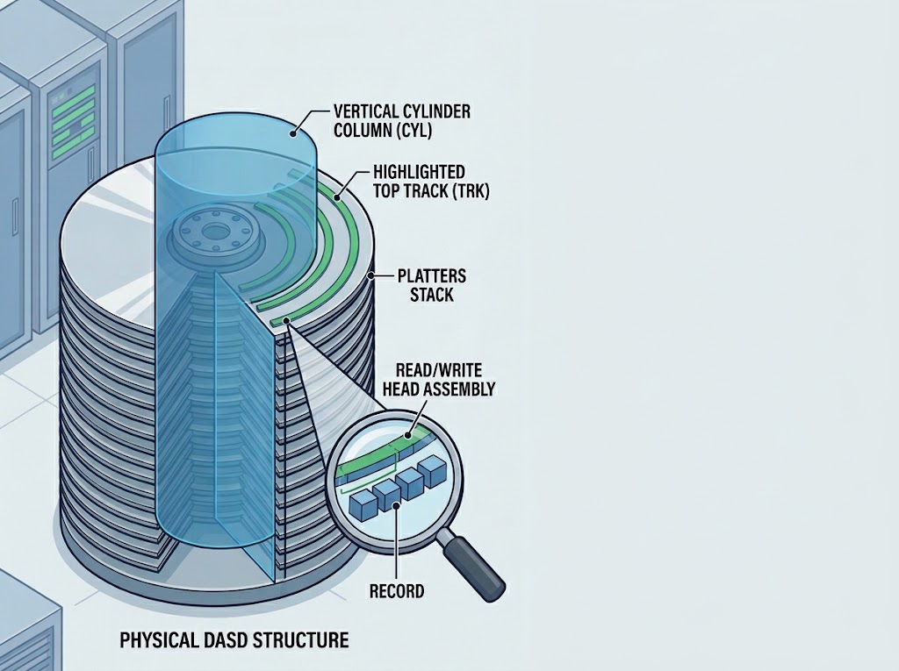

# JCL Practices: Practice 2 - Record Filtering with DFSORT

## 📋 Job Overview
This practice demonstrates how to use **IBM DFSORT** in z/OS to **filter records** from an input dataset based on a specific character condition, while maintaining the original sequence of the data using `SORT FIELDS=COPY`.

---

🛠️ 
## ⚙️ Technical Specifications

* PGM=SORT: Invokes the standard IBM DFSORT utility.
* SYSOUT=* & SYSPRINT: Directs runtime logs, diagnostics, and utility execution reports directly to the SDSF spool for easy monitoring.
* SORT FIELDS=COPY: Instructs the utility to bypass sorting or rearranging the records, copying them sequentially to the output dataset as they are filtered.

* INCLUDE COND=(12,10,CH,GT,C'2026-05-01'): The filtering logic:
    - 12: Starting byte/column position.
    - 10: Length of the field to evaluate.
    - CH: Character data type.
    - GT: Greater than operator.
    - C'2026-05-01': Literal comparison value (filters records where the date is after May 1, 2026).

---

## 📥 Input Dataset
* **DSN:** `Z#####.INPUT(TRANSCRD)`
* **Record Example:**
```text                                     
1234567890 2026-01-21 00015000 MXN APROBADA 
1235496822 2026-01-22 00007000 USD RECHAZADA
9852321000 2026-01-12 00900500 MXN FRAUDE   
1234567890 2026-08-21 00015000 MXN APROBADA 
1235496822 2026-05-13 00007000 USD RECHAZADA
5468444444 2026-05-05 00900500 MXN FRAUDE   
9698923546 2026-03-18 00015000 MXN APROBADA 
6662355544 2026-04-30 00007000 USD RECHAZADA
7894516330 2026-07-11 00900500 MXN FRAUDE   
```

---

🚀 Execution & Verification
1. Submit the job via VS Code using Zowe Explorer or TSO/ISPF submit command.
2. Check SDSF to ensure the job completed successfully with return code CC 0000.
3. Inspect the output dataset member Z80256.OUTPUT(CREDOUT2) to verify that only the filtered records were written.

