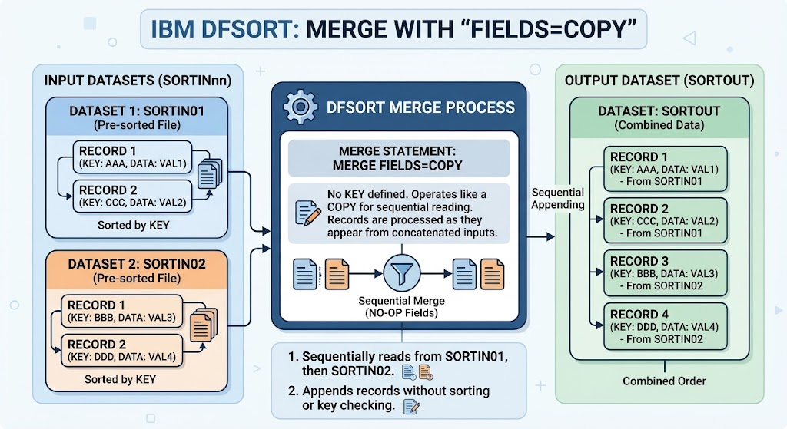

Markdown
# JCL Practices: Combining Datasets Using DFSORT UNION (MERGE FIELDS=COPY)

## 📋 Job Overview
This practice demonstrates how to merge two separate input sequential datasets into a single consolidated output file using **IBM DFSORT**. By providing multiple `DD` statements under `SORTIN` and utilizing the `MERGE FIELDS=COPY` control statement, records from different sources are combined in a single execution step.

---

## ⚙️ JCL Architecture & Pipeline

The job consists of two sequential steps:
1. **`BORRADO` (`IEFBR14`):** Pre-job cleanup step that safely deletes the target output dataset (`Z80256.OUTPUT.UNION01`) if it already exists, preventing catalog allocation errors (`IGD17101I`).
2. **`UNION` (`PGM=SORT`):** The core processing step that reads from multiple input members/datasets and writes the merged result to the cataloged output dataset.

---

## 🔍 Key Technical Concepts
* Multiple `SORTIN DD` Concatenation: 
    DFSORT allows appending multiple input datasets directly by sequencing //DD cards under the SORTIN DD name, processing them sequentially as a unified input stream.

* `MERGE FIELDS=COPY`: 
    Instructs the utility to merge the input streams without applying custom sorting keys, preserving the exact layout and sequence of the records while combining them.

* Safe Dataset Allocation: 
    Utilizes `IEFBR14` with `DISP=(MOD,DELETE)` to handle conditional cleanup seamlessly before dataset creation.

---

## 🚀 Execution & Verification
1. Expected Return Code: MAXCC 0000
2. Verification Tool: Check output status via SDSF and browse `Z80256.OUTPUT.UNION01` to confirm that records from both `TRANSCRD` and `TRANSCD2` are successfully concatenated.

