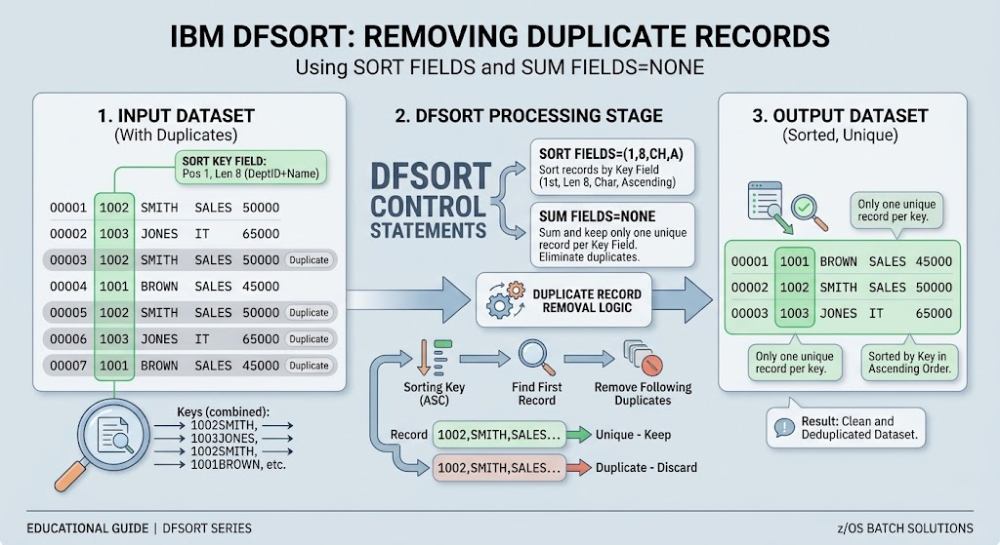

# JCL Practices: Removing Duplicate Records Using DFSORT (SUM FIELDS=NONE)

## 📋 Job Overview
This practice demonstrates how to eliminate duplicate records from a sequential dataset using **IBM DFSORT**. By combining `SORT FIELDS` to define the unique key criteria and the `SUM FIELDS=NONE` control statement, DFSORT identifies and suppresses duplicate records based on the specified key columns, writing only unique records to the target output file.

---

## ⚙️ JCL Architecture & Pipeline

The job consists of two sequential steps:
1. **`BORRADO` (`IEFBR14`):** Pre-job cleanup step that safely deletes the target output dataset (`Z80256.OUTPUT.SINDUPLI`) if it already exists, avoiding catalog and allocation conflicts (`IGD17101I`).
2. **`UNION` (`PGM=SORT`):** The core sorting and deduplication step that reads the input dataset (`COMPANY`), applies the sorting and suppression logic, and catalogs the deduplicated output.

---

## 🔍 Key Technical Concepts
* `SORT FIELDS=(1,16,CH,A)`: 
    Establishes the primary sort key starting at byte position 1, with a length of 16 bytes, defined as Character (CH) data, sorted in Ascending (A) order. This key acts as the criteria for identifying duplicates.

* `SUM FIELDS=NONE`: 
    Instructs DFSORT to suppress records that share identical sort keys. When duplicates are encountered based on the key fields, only the first occurrence is kept, and subsequent duplicates are dropped.

* Job Card Optimization: The programmer name field is kept concise to comply with JES constraints (HASP110).

---

## 🚀 Execution & Verification
1. Expected Return Code: MAXCC 0000
2. Verification Tool: Inspect output via SDSF and browse Z80256.OUTPUT.SINDUPLI to confirm that redundant rows have been successfully filtered out.

