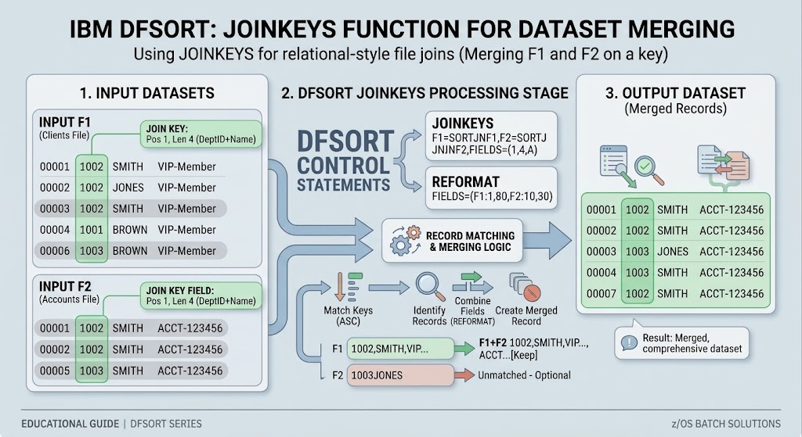

# JCL Practices: Joining Keys from two different files with JOINKEYS
                                                                                                                                         
## 📋 Job Overview                                                        

This practice demonstrates how to perform a relational file join (merge) between two independent sequential datasets (CLIENTS and ACCOUNTS) using `IBM DFSORT JOINKEYS`. 
By leveraging `JOINKEYS` to define the cross-reference keys, `REFORMAT` to extract specific fields from both inputs, and `OUTREC` to insert constant separators (C' '), `DFSORT` creates a clean, formatted composite record written to the target output file.

---

## ⚙️ JCL Architecture & Pipeline

The job consists of two sequential steps:BORRADO (`IEFBR14`): 
* Pre-job cleanup step that safely deletes the target output dataset (Z80256.OUTPUT.JOINKEYS) if it already exists, avoiding catalog and allocation conflicts (IGD17101I).
* `JOINKEYS (PGM=SORT)`: The core merging step that reads the input datasets from SORTJNF1 (CLIENTS) and SORTJNF2 (ACCOUNTS), aligns records matching the join key, formats the output buffer with an explicit column separator, and catalogs the result.

---

## 🔍 Key Technical Concepts

1. `JOINKEYS FILE=F1/F2,FIELDS=(1,4,A)`:
    Establishes the match key starting at byte position 1 with a length of 4 bytes in ascending order for both input datasets (SORTJNF1 and SORTJNF2).

2. `REFORMAT FIELDS=(F1:5,21,F2:5,10)`:
    Extracts 21 bytes from F1 (Client details) and 10 bytes from F2 (Account details) after skipping the 4-byte join key. 
    This generates an intermediate 31-byte joined record (ICE419I).

3. `OUTREC FIELDS=(1,21,C' ',22,10)`:
    Reorganizes the 31-byte joined record by placing the first 21 bytes, inserting a single blank space constant (C' '), and appending the remaining 10 bytes starting from position 22.

4. `Length Synchronization (ICE027A Avoidance)`:
    Prevents record length overflow errors by strictly aligning OUTREC field references with the total byte count provided by the REFORMAT buffer ($21 + 10 = 31 \text{ input bytes}$).

5. `Job Card Optimization`: The programmer name field is kept concise to comply with JES constraints (HASP110).

---

## 📥 Input Dataset                         
* **DSN:** `Z#####.INPUT(CLIENTS)`         
* **Record Example:**                       
```text                                     
0001JUAN PEREZ        VIP
0002MARIA GOMEZ       REG
0003CARLOS RUIZ       VIP
0004ANA LOPEZ         NEW
0005LUIS TORRES       REG
0006SOFIA DIAZ        VIP

```                                         
* **DSN:** `Z#####.INPUT(ACCOUNTS)`        
* **Record Example:**                     
```text                 
0001ACC-9876540015000
0003ACC-1234560085000
0005ACC-5554440032000
0006ACC-7778880099000
0007ACC-9990000012000
```                                 

--- 
## 🚀 Execution & Verification

* Expected Return Code: MAXCC 0000 ($HASP395 JOINKEYS ENDED - RC=0000).
* Verification Tool: 
    Inspect output via SDSF and browse Z80256.OUTPUT.JOINKEYS. 
    Press F3 to refresh ISPF display cache and confirm that client names and bank accounts are properly joined with a single space separator.

