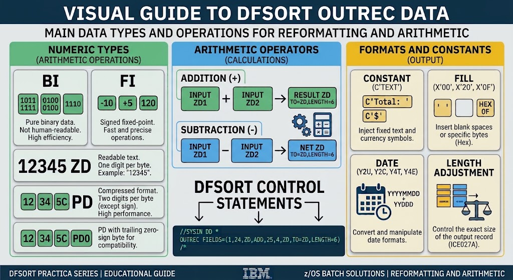

# JCL Practices: DFSORT Arithmetic Operations & Data FormattingOverview                          
                                                                                                
## 📋 Job Overview                                                                              

This project demonstrates how to perform batch arithmetic calculations directly within IBM DFSORT using `OUTREC` control statements on z/OS. It illustrates field reformatting, handling Zoned Decimal (ZD) data types, and injecting formatted output strings without needing an external COBOL program.

---

## ⚙️ JCL Architecture & Pipeline

The pipeline for **Practice 07** consists of a sequential z/OS batch job structured to read raw fixed-blocked records, execute inline arithmetic calculations via DFSORT, and output formatted results with zero data exceptions (`S0C7`) or syntax errors (`ICE007A`).

[ Z80256.INPUT.EMPLOYEE ]
│
▼
┌─────────────────────────┐
│     Step: CALCULO       │
│  - Program: PGM=SORT    │
│  - SORT FIELDS=COPY     │
│  - OUTREC Arithmetics   │
└─────────┬───────────────┘
│
▼
[ Z80256.OUTPUT.REPORT ]


---                                               
                            
## 🔍 Key Technical Concepts

1.  `Fixed Blocked (FB)` File Structure
    In z/OS batch processing, sequential files strictly align data contiguous by precise byte offsets rather than using delimiters like CSVs:
    * Record Length (LRECL): 34 Bytes
    * Record Format (RECFM): Fixed Blocked (FB)

2. Data Types: `ZD (Zoned Decimal)` vs `PD (Packed Decimal)` 
    * Zoned Decimal (ZD): 
        Human-readable, 1 byte = 1 digit. Ideal for text files and straightforward external inputs/outputs.
    * Packed Decimal (PD / COMP-3): 
        Binary-compressed, 2 digits per byte + trailing sign half-byte. Used for high-efficiency CPU arithmetic operations and financial processing.
    Key Takeaway: Arithmetic operands within DFSORT (ADD, SUB, MUL) must maintain data type consistency. Performing operations between ZD and PD without proper conversion triggers syntax errors (ICE007A) or data exceptions (ABEND S0C7).
3. `SORT FIELDS=COPY`: Preserves the original sequence of employee records while passing data through the reformatter.
4. 1,24: Passes through the employee ID and name fields intact (bytes 1 through 24).
5. 25,6,ZD + ADD + 31,4,ZD: Reads the Base Salary (6 bytes, Zoned Decimal) and Bonus (4 bytes, Zoned Decimal) directly from their   respective input positions, performing an in-stream arithmetic addition.
6. `TO=ZD`,`LENGTH=6`: Converts the resulting sum back into readable Zoned Decimal format with a standardized length of 6 bytes.

---                                                              
                                      
## 📥 Input Dataset                   
* **DSN:** `Z#####.INPUT(EMPLOYEE)`    
* **Record Example:**                 
```text                               
E001JUAN PEREZ          0050000500
E002MARIA GOMEZ         0062000750
E003PEDRO LOPEZ         0045000300
E004CARLOS RUIZ         0078001200
E005ANA TORRES          0055000450
```

## 📥 Output Dataset                 
* **DSN:** `Z#####.INPUT.SALARY` 
* **Record Example:**               
```text                               
E001JUAN PEREZ           - Total: 005500
E002MARIA GOMEZ          - Total: 006950
E003PEDRO LOPEZ          - Total: 004800
E004CARLOS RUIZ          - Total: 009000
E005ANA TORRES           - Total: 005950
```
---

### Troubleshooting LogDuring development

Two critical mainframe execution errors were diagnosed and resolved:
* ABEND S0C7 (Data Exception): 
    Occurred when reading invalid byte coordinates or mismatched types. 
    Resolved by correctly mapping raw input bytes.
* ICE007A (Syntax Error): 
    Triggered when line length crossed column 71 or when using non-standard comment styles (/* ... */) within DFSORT control cards. Resolved by using clean line continuations and keeping code within columns 1–71.

---                           
## 🚀 Execution & Verification

* Job Condition Code: MAXCC=0000 (Successful Execution)
* Target Environment: z/OS V3R1 / IBM DFSORT

